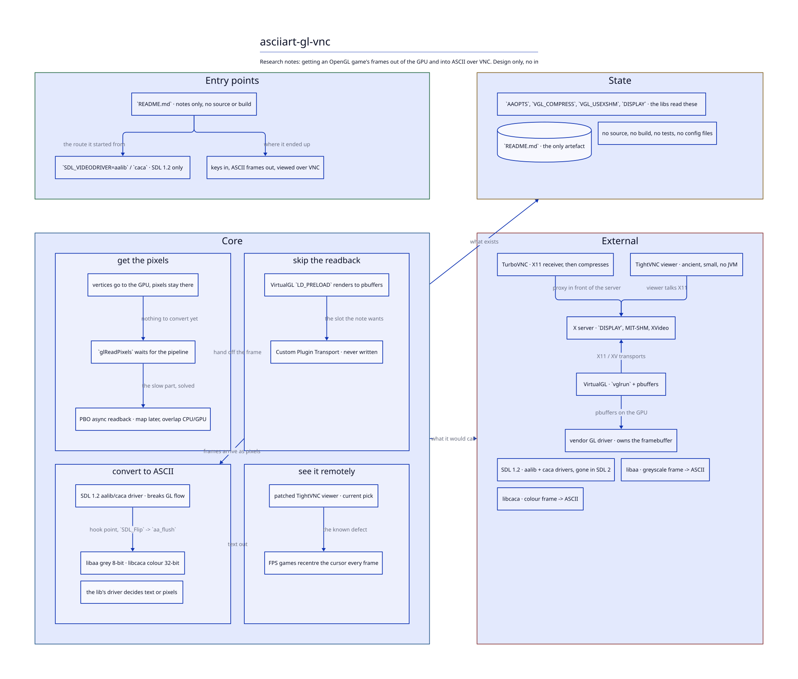

# asciiart-gl-vnc

Research notes on turning a running Linux OpenGL game into ASCII art over VNC — the design is worked out in prose, but nothing here is built yet.

Read it left to right:

- **The pixels are the entire problem.** An OpenGL game sends vertices to the GPU and the frame never comes back; `glReadPixels` can fetch it but blocks until the pipeline drains. The note's answer is a pixel buffer object: copy asynchronously, map and read later, so CPU and GPU overlap instead of waiting.
- **The obvious route is a dead end for 3D.** `SDL_VIDEODRIVER=aalib` / `caca` only exist in SDL 1.2, and they work by hooking SDL (`SDL_Flip` calls `aa_flush`) while expecting the app to blit into an SDL surface. A GL game never touches that surface, so the driver has nothing to convert — and the hooks disturb the GL flow anyway.
- **libaa and libcaca are the easy half.** Both just take a frame — grey 8-bit for libaa, colour 32-bit for libcaca — and their own "driver" setting decides text or pixels. The hard part was never the ASCII conversion; it was getting a frame that lives on the GPU into their hands.
- **VirtualGL is borrowed to avoid writing pbuffer code.** `LD_PRELOAD` makes the app render offscreen, then one of four transports carries frames out (VGL image, X11, XV, custom plugin). The Custom Plugin Transport is the documented place to intercept and convert instead — it is named here and never written.
- **Nothing is implemented, and the current plan is downstream of the problem.** The repo is 112 lines of README; the author's pick is patching a TightVNC viewer, precisely because viewers mishandle the cursor that first-person games recentre every frame.

Diagram source: [`docs/system.d2`](docs/system.d2) · renderer: [`scripts/render-diagram.sh`](scripts/render-diagram.sh).
